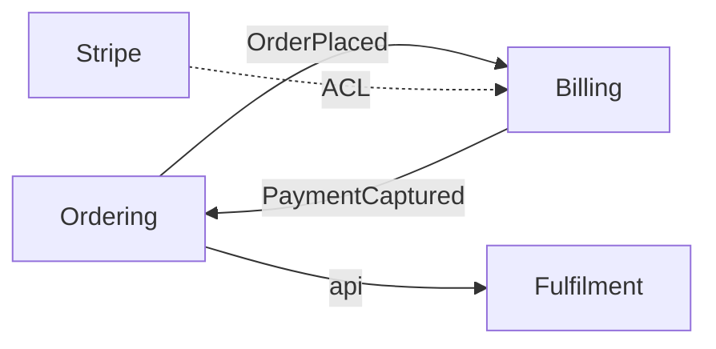

# Context Mapping

## Relationship patterns

| Pattern | Meaning | Use when | Code consequence |
|---|---|---|---|
| **Partnership** | Two contexts change together by agreement | Same team, tightly coordinated | Shared contract tests; coordinate releases |
| **Shared Kernel** | A small model both contexts import | Truly identical concepts (Money, CountryCode) | `shared_kernel` package; tiny, stable, heavily tested; changes need both owners |
| **Customer–Supplier** | Upstream serves downstream's needs | Downstream can negotiate | Upstream publishes a versioned API module; downstream has contract tests against it |
| **Conformist** | Downstream adopts upstream's model as-is | No leverage, model is acceptable | Downstream imports upstream's *public* API types directly; accept the coupling knowingly |
| **Anti-Corruption Layer** | Downstream translates upstream into its own model | Legacy, third-party, or a model that would pollute yours | `<context>/infrastructure/acl/` with translators; upstream types never appear in `<context>/domain` |
| **Open Host Service / Published Language** | Upstream offers a stable protocol for many consumers | Many downstreams | Explicit schema (JSON Schema, protobuf, pydantic models in `api/`) versioned independently of the domain |
| **Separate Ways** | No integration | The cost of integrating exceeds the value | Nothing; record the decision |

## Default stance

- Between your own contexts: **Customer–Supplier** via a public `api` module, communicating with **integration events** or DTOs, never domain objects.
- Against any external system: **Anti-Corruption Layer**. Always.
- **Shared Kernel** only for value objects with no behaviour that could diverge. If in doubt, duplicate. Duplication between contexts is cheaper than coupling.

## Context map format (`docs/domain/context-map.md`)

```markdown
# Context Map

## Contexts
| Context | Type | Owner | Package |
|---|---|---|---|
| Ordering | Core | Checkout team | `shop.ordering` |
| Billing | Supporting | Payments team | `shop.billing` |
| Fulfilment | Supporting | Ops | `shop.fulfilment` |
| Identity | Generic | (Auth0) | `shop.identity` (ACL only) |

## Relationships
| Upstream | Downstream | Pattern | Integration |
|---|---|---|---|
| Ordering | Billing | Customer–Supplier | `OrderPlaced` integration event |
| Billing | Ordering | Customer–Supplier | `PaymentCaptured` integration event |
| Stripe | Billing | ACL | `billing.infrastructure.acl.stripe` |
| Ordering | Fulfilment | Customer–Supplier | `ordering.api.get_order_for_fulfilment()` |


```
